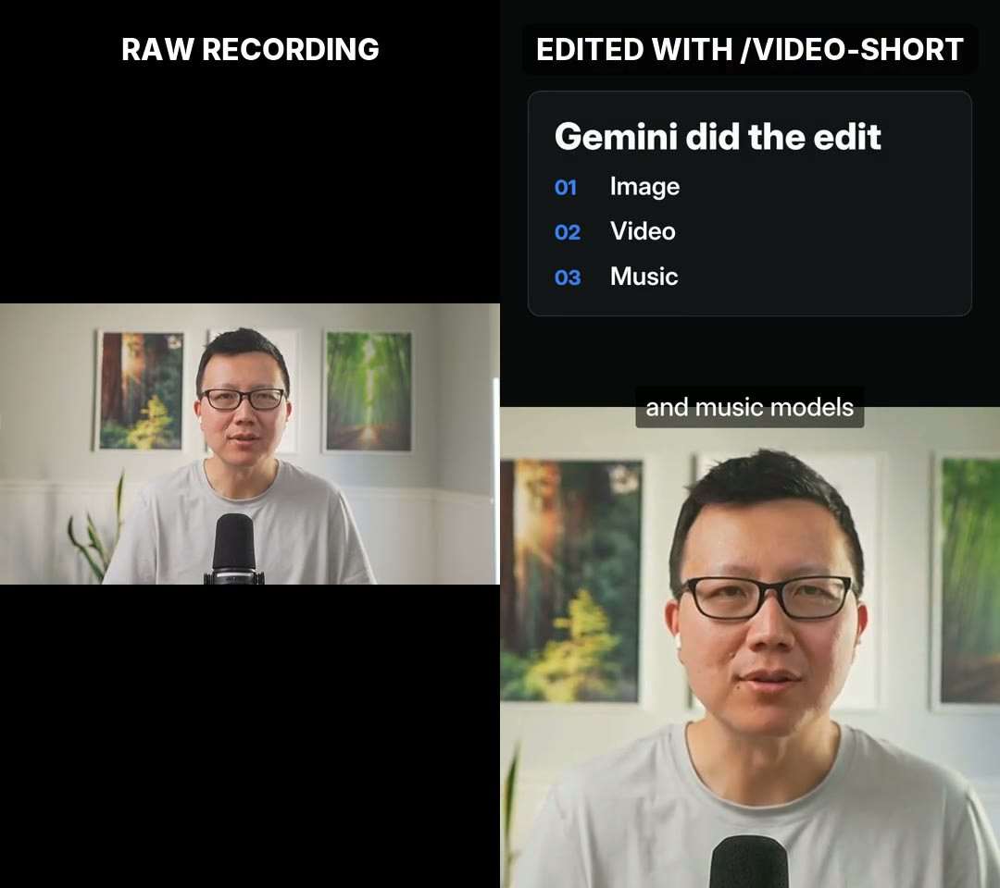

# Video Short

Turn a raw talking-head recording into a finished YouTube Short with B-roll, motion graphics, and captions, edited by your AI coding agent.



<!-- Before publishing: drag assets/before-after.mp4 into this README on GitHub and replace this line with the user-attachments link it creates. -->

## Problem

Editing a 40-second Short still takes an hour: cutting retakes, reframing a landscape shot for vertical, timing captions word by word, finding B-roll, and animating the one stat you mention.

Most AI video tools hide those decisions inside an app you can't steer. Video Short has your coding agent make every editing call in a plain text file you can read and change, then shows you the result on a real video timeline before it renders.

## How to install Video Short

The easiest way to install the skill is to paste this into Claude Code, Codex, Antigravity, or your favorite coding agent:

```text
Install the /video-short skill globally from https://github.com/petergyang/video-short
```

You can also install it with `npx`:

```sh
npx skills add petergyang/video-short --skill video-short --global --yes
```

### Requirements

- **ffmpeg** with ffprobe. On a Mac: `brew install ffmpeg`.
- **Python 3.10 or newer.** The skill creates its own environment on first run and downloads the local Parakeet speech model (about 600 MB), so transcription stays on your computer.
- **Node.js 22 or newer** for [HyperFrames](https://github.com/heygen-com/hyperframes), the free, open-source renderer that turns HTML into video. On a Mac: `brew install node`. HyperFrames downloads a headless Chrome on first run.
- **Optional: yt-dlp** for pulling clips from YouTube, X, and other sites. On a Mac: `brew install yt-dlp`.
- **Optional: A Gemini API key** for generated music with Lyria. Get a free key at [Google AI Studio](https://aistudio.google.com/apikey) and set `GEMINI_API_KEY`. You can also bring your own track from Suno or any music library.

No account or paid API is required.

## How to use Video Short

```text
/video-short edit my recording at ~/Videos/raw.mp4 into a Short
```

The skill works in four steps:

1. **Cut.** It transcribes the recording locally, reads every line, and removes retakes, false starts, and dead air. It picks the framing and color grade by looking at frames from your video.
2. **Plan.** It writes `edit.md`, a readable plan with each scene's timing, layout, and visual. It pulls clips from your footage, YouTube, X, or the media in a blog post, and animates the rest.
3. **Review.** It opens the Short in HyperFrames Studio, where you can play it, scrub the timeline, and tell your agent what to change.
4. **Render.** It renders the Short with captions, clips, motion graphics, and music, then checks loudness, sync, and every cut before handing it back.

Each render saves a new version, so you can compare `v1` and `v2`.

## What goes on screen

Every Short cuts between four layouts on spoken words:

1. **A-roll:** You, full screen.
2. **Punch:** A tighter shot of you for emphasis.
3. **Split:** A visual on top, you below.
4. **B-roll:** A visual full screen while your voice continues.

Visuals always move:

- **Clips** from your footage or the web, with a slow push-in.
- **List cards** that add one row as you say each item.
- **Numbers** that count up to the stat you mention.
- **Custom graphics** your agent writes in HTML for anything else, like a flow or a before and after.

Captions show three or four words at a time on a quiet band, with an occasional highlighted key term. Music is optional. Sound effects are off by default, and you can ask for subtle ones.

## Make it yours

Captions, cards, and colors come from a small `style.json`. Save yours at `~/.config/video-short/style.json` with your fonts and colors, and every Short uses it. The keys are in [`reference.md`](skills/video-short/reference.md).

## What's inside

- [`SKILL.md`](skills/video-short/SKILL.md) contains the editing rules and workflow.
- [`reference.md`](skills/video-short/reference.md) contains the commands, the `edit.md` format, graphics, and style options.
- [`eval.md`](skills/video-short/eval.md) contains the checks the skill runs before handing back a video.
- [`scripts/`](skills/video-short/scripts) contains the Python scripts for transcription, cutting, building the HyperFrames project, rendering, and QA.

## Want more great AI skills?

Check out [Behind the Craft](https://behindthecraft.com), my personal AI system with over a dozen other quality skills and courses.

Subscribe to my [YouTube channel](https://www.youtube.com/@PeterYangYT?sub_confirmation=1) and [newsletter](https://creatoreconomy.so) for practical AI tutorials and interviews.

## License

MIT. The bundled Inter font is under the [SIL Open Font License](skills/video-short/fonts/OFL.txt).
