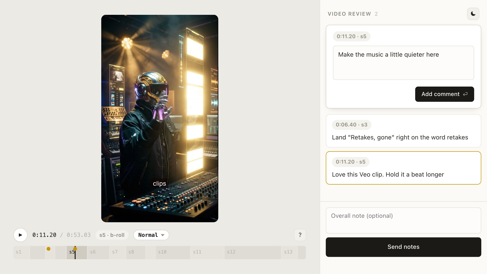
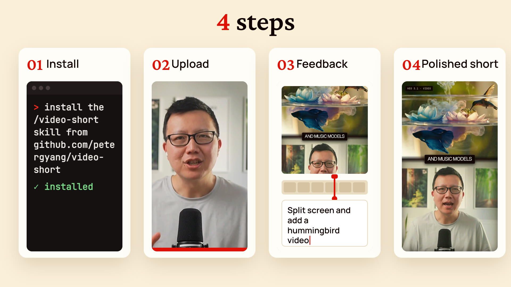

# Video Short

Turn a raw recording into a polished video short, complete with B-roll, motion graphics, captions, music, and more using Claude, ChatGPT, Gemini, or your favorite agent.

https://github.com/user-attachments/assets/51b8decf-d719-4f4b-9824-5686b3a97ac7

[Watch the full tutorial](https://youtu.be/NWll-9p84b4) to see how I use this skill with a real example.

## Problem

Shorts average 200 billion daily views on YouTube alone, but making a great one by hand still takes hours. And when you ask AI to help, giving feedback in chat is painful because you can't point at the exact frame you want to fix.

## What video short can do

/video-short makes it easy for you to iterate with AI to create compelling shorts. The best part of the skill is it gives you a review page to give feedback to your AI agent on any frame until the short feels right:

<picture>
  <source media="(prefers-color-scheme: dark)" srcset="assets/review-dark.jpg">
  
</picture>

The skill supports making shorts with 4 different layouts:

1. **A-roll:** You, full screen.
2. **Motion graphics** to bring the short to life.
3. **Split:** A visual on top, you below.
4. **B-roll:** A visual full screen while you keep talking.

It can also add the following automatically:

- **Captions** that match what you say, word for word.
- **Motion graphics** written in HTML to bring the short to life.
- **B-roll footage** found online that's relevant to what you're saying.
- **AI video and music (optional)** generated with Gemini Veo and Lyria. This step needs a [Gemini API key](https://aistudio.google.com/?utm_source=peteryang&utm_medium=partner&utm_campaign=26Q3-peteryang_ais) with billing enabled. You can also add your own video and music.

## How to install video short

To install the skill, just paste this into Claude Code, ChatGPT Desktop, or your favorite agent:

```text
Install the /video-short skill globally from https://github.com/petergyang/video-short
```

You can also install it with `npx`:

```sh
npx skills add petergyang/video-short --skill video-short --global --yes
```

The first time you run the skill, it'll check if you have the following installed and offer to install what's missing. Plan for around 1 GB of disk space, mostly for the speech model:

- **[ffmpeg](https://ffmpeg.org)** to cut and encode video.
- **[yt-dlp](https://github.com/yt-dlp/yt-dlp)** to pull B-roll from YouTube, X, and other sites.
- **[Python](https://www.python.org) 3.10 or newer** to run the editing scripts.
- **[Node.js](https://nodejs.org) 22 or newer** for [HyperFrames](https://github.com/heygen-com/hyperframes), the free, open-source tool that transcribes your recording on your computer with the [Parakeet](https://huggingface.co/nvidia/parakeet-tdt-0.6b-v3) speech model and renders the edit into video.
- **Optional: A Gemini API key** with billing enabled, to generate images with Nano Banana, video clips with Veo, and music with Lyria. Get a key at [Google AI Studio](https://aistudio.google.com/?utm_source=peteryang&utm_medium=partner&utm_campaign=26Q3-peteryang_ais) and set `GEMINI_API_KEY`.

## How to use video short

I've made this skill as simple as possible to use, just follow these 4 steps:



1. **Install.** Paste the install prompt above into Claude Code, ChatGPT, or your favorite AI agent. You only do this once.
2. **Upload.** Record yourself talking, then run the skill and point it at your raw video:

   ```text
   /video-short edit my video at [path/to/video.mp4]
   ```

   It'll transcribe the recording and cut retakes, false starts, and dead air.
3. **Plan.** It researches the topic, finds B-roll from your footage and the web, and shows you a table of every scene in chat: what's on screen, the words spoken, and anything it wants to generate. Reply "go" or ask for changes.
4. **Iterate.** Once your agent is done with a draft edit, it'll open the review page for you to play the short, pause on any frame, and leave feedback. The agent will then apply your feedback before reloading the review page with a new version of the short.

Each render saves a new version, so you can compare `v1` and `v2`, plus a small 720p copy in `renders/share/` to send from your phone or email.

## Make it yours

Fonts, colors, and caption style come from a small `style.json`. Save yours at `~/.config/video-short/style.json` and every short uses it. The keys are in [`reference.md`](skills/video-short/reference.md).

## What's inside

- [`SKILL.md`](skills/video-short/SKILL.md) contains the editing rules and workflow.
- [`reference.md`](skills/video-short/reference.md) contains the commands, the `edit.md` format, graphics, and style options.
- [`eval.md`](skills/video-short/eval.md) contains the checks the skill runs before handing back a video.
- [`scripts/`](skills/video-short/scripts) contains the scripts for setup, transcription, cutting, generation, rendering, the review page, and QA.

## Want more great AI skills?

Become a paid member at [Behind the Craft](https://behindthecraft.com) to get all my AI skills, $600+ in AI tool discounts, and my personal AI course.

Subscribe to my [YouTube channel](https://www.youtube.com/@PeterYangYT?sub_confirmation=1) and [newsletter](https://creatoreconomy.so) for practical AI tutorials and interviews.

## License

MIT. The bundled Inter font is under the [SIL Open Font License](skills/video-short/fonts/OFL.txt).
